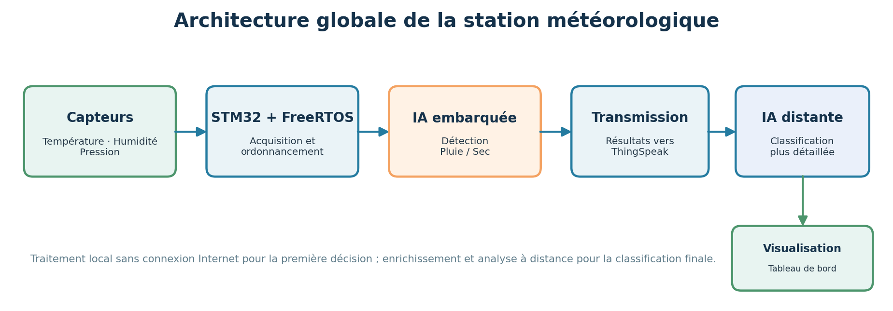
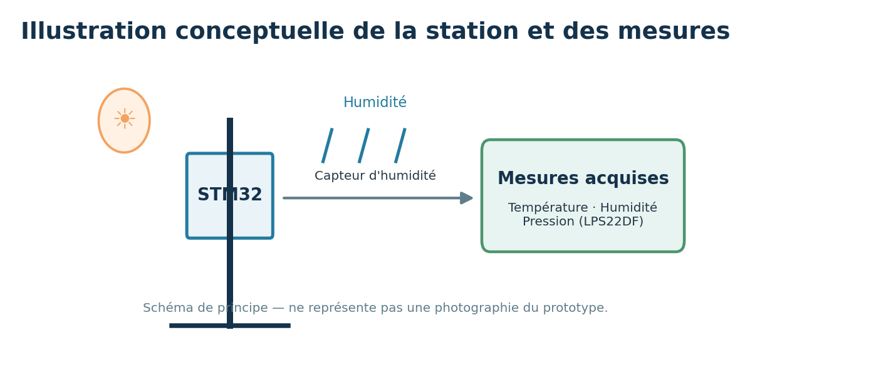
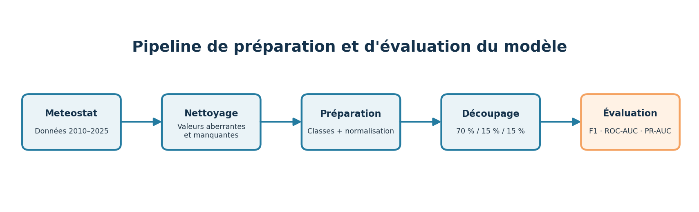
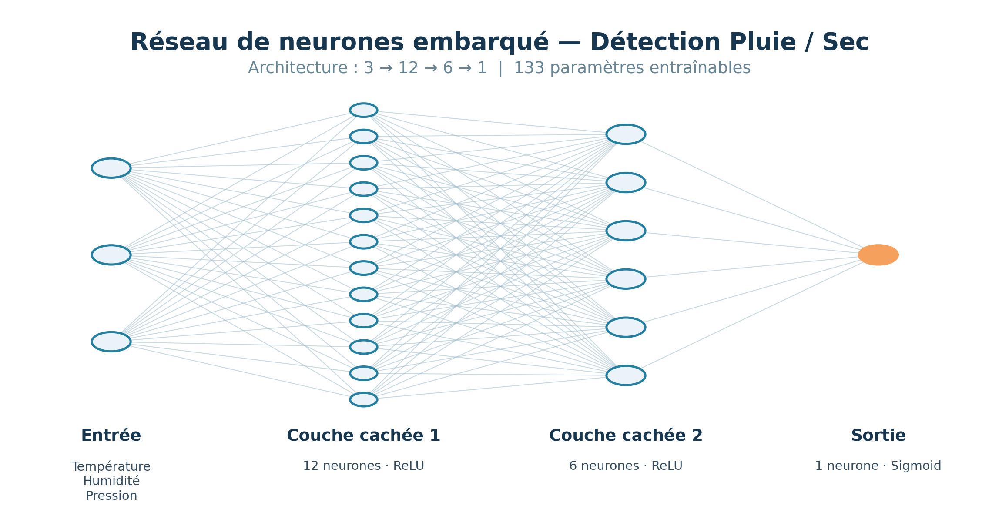
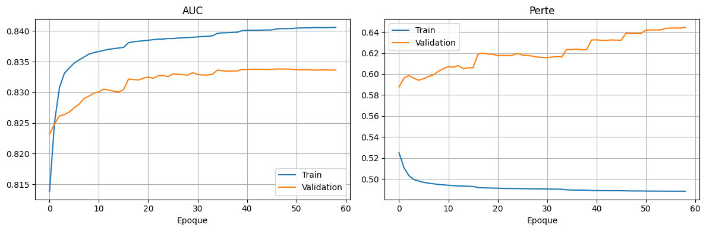
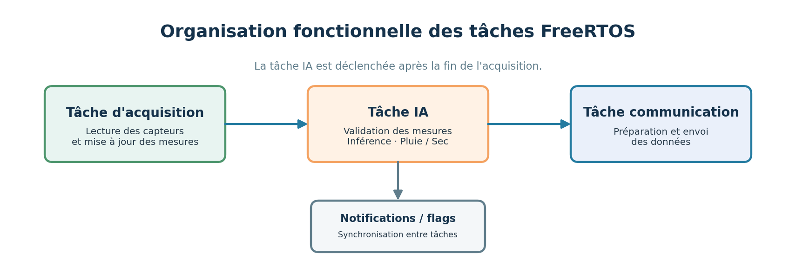
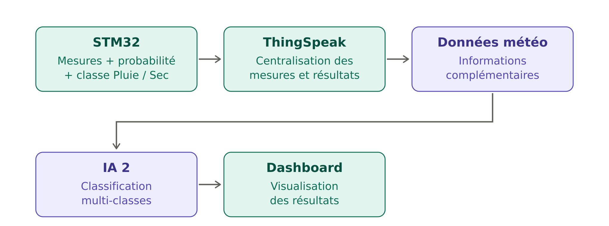

# 🌦️ Station météorologique intelligente – Intelligence artificielle embarquée et distante

<p align="center">
  
  
  
  
  
</p>

## 📌 Présentation du projet

Ce projet consiste à développer une **station météorologique intelligente** capable d'analyser les conditions météorologiques grâce à deux intelligences artificielles complémentaires.

La première intelligence artificielle est embarquée directement sur un microcontrôleur STM32. Elle utilise les mesures de température, d'humidité et de pression atmosphérique pour détecter la présence de pluie.

La seconde intelligence artificielle fonctionne à distance, sur la plateforme ThingSpeak. Elle exploite le résultat de la première IA ainsi que des données météorologiques complémentaires afin d'affiner la classification et de distinguer différents phénomènes météorologiques : pluie, averse, neige ou temps sec.

L'ensemble permet de combiner **traitement local, acquisition de données météorologiques et analyse intelligente à distance**.

---

## 🎯 Objectifs

- Mesurer les principaux paramètres météorologiques à l'aide de capteurs.
- Développer une intelligence artificielle capable de détecter la pluie.
- Intégrer le modèle directement sur un STM32.
- Exploiter FreeRTOS pour organiser les différentes tâches du système.
- Transmettre les résultats vers ThingSpeak.
- Enrichir les données avec des informations météorologiques complémentaires.
- Développer une seconde IA pour classifier plus précisément les phénomènes météorologiques.
- Visualiser les mesures et les prédictions à distance.

---

# 🏗️ 1. Architecture générale du système

Le système repose sur deux niveaux de traitement indépendants mais complémentaires.

<p align="center">
  
</p>

*Figure 1 — Architecture globale : acquisition, traitement embarqué, transmission et classification distante.*

### Fonctionnement général

1. Les capteurs acquièrent les données météorologiques.
2. Le STM32 récupère les mesures.
3. La première IA effectue une détection Pluie / Sec.
4. Les résultats sont transmis à ThingSpeak.
5. Des données météorologiques complémentaires sont récupérées.
6. La deuxième IA réalise une classification météorologique plus détaillée.
7. Les résultats finaux sont visualisés sur ThingSpeak.

---

# 🌡️ 2. Acquisition des données météorologiques

La station utilise des capteurs connectés au STM32 pour mesurer les paramètres nécessaires à la première intelligence artificielle.

### Mesures réalisées sur la carte

| Paramètre | Unité | Utilisation |
|---|---:|---|
| Température | °C | Analyse des conditions météorologiques |
| Humidité relative | % | Identification des conditions favorables à la pluie |
| Pression atmosphérique | hPa | Analyse de l'évolution des conditions atmosphériques |

**Capteur de pression : LPS22DF**

La pression mesurée à l'altitude de la station est convertie en pression ramenée au niveau de la mer avant d'être utilisée par le modèle.

Cette correction permet de conserver la cohérence entre les données d'entraînement et les mesures réelles.
<!--
<p align="center">
  
</p>
-->
*Figure 2 — Illustration conceptuelle du système d'acquisition. À remplacer ou compléter par une photographie du prototype réel.*

---

# 🧠 3. Première intelligence artificielle – STM32

## Détection Pluie / Sec

La première IA est entraînée en Python à partir de données météorologiques historiques provenant de Meteostat.

Les données utilisées proviennent de la station de Chambéry-Aéroport (07491), sur la période allant de 2010 à 2025.

### 3.1. Données d'entraînement

Les trois variables utilisées comme entrées sont :

- Température.
- Humidité relative.
- Pression atmosphérique.

La variable cible est construite à partir des codes météorologiques Meteostat.

| Classe | Signification |
|---|---|
| 0 | Sec |
| 1 | Pluie |

Les phénomènes météorologiques qui ne correspondent pas clairement à ces deux catégories sont écartés de l'entraînement.

### 3.2. Préparation des données

Les données passent par plusieurs étapes :

- Nettoyage des valeurs aberrantes.
- Suppression des observations incomplètes.
- Création des classes binaires.
- Normalisation des variables.
- Séparation chronologique des données.

<p align="center">
  
</p>

*Figure 3 — Étapes de préparation et d'évaluation du modèle.*

| Ensemble | Proportion |
|---|---:|
| Entraînement | 70 % |
| Validation | 15 % |
| Test | 15 % |

Une pondération des classes est également appliquée afin de limiter les effets du déséquilibre entre les observations de pluie et de temps sec.

### 3.3. Architecture du réseau de neurones

Le réseau de neurones est développé avec TensorFlow / Keras.

<p align="center">
  
</p>

*Figure 4 — Architecture du réseau de neurones embarqué.*

**Architecture : 3 → 12 → 6 → 1**

| Caractéristique | Valeur |
|---|---|
| Entrées | 3 |
| Couche cachée 1 | 12 neurones |
| Couche cachée 2 | 6 neurones |
| Sortie | 1 neurone |
| Activation cachée | ReLU |
| Activation de sortie | Sigmoid |
| Optimiseur | Adam |
| Fonction de perte | Binary Crossentropy |
| Paramètres entraînables | 133 |

La sortie du réseau correspond à un score compris entre 0 et 1.

Un seuil de décision est déterminé à partir des données de validation en maximisant le score F1 de la classe Pluie.

### 3.4. Évaluation du modèle

Les performances sont évaluées sur un ensemble de test indépendant.

Les indicateurs utilisés sont :

- Accuracy.
- Precision.
- Recall.
- F1-score.
- ROC-AUC.
- PR-AUC.
- Matrice de confusion.

<p align="center">
  
</p>

### 3.5. Intégration sur STM32

Après l'entraînement, les poids du réseau et les paramètres de normalisation sont exportés en fichiers C et H.

L'inférence est ensuite exécutée directement sur le microcontrôleur.

Le calcul est réalisé en Float32, à partir des poids exportés du modèle TensorFlow.

La fonction de prédiction retourne :

- La probabilité de pluie.
- La classification Pluie / Sec.
- Un indicateur de validité des mesures.

Cette approche permet d'effectuer la première analyse localement, sans dépendre d'une connexion Internet.

---

# ⚙️ 4. Gestion temps réel avec FreeRTOS

Le fonctionnement du système est organisé autour de plusieurs tâches FreeRTOS.

<p align="center">
  
</p>

*Figure 5 — Organisation fonctionnelle des tâches FreeRTOS.*

### Fonctionnement de la tâche IA

La tâche IA est déclenchée après la fin de l'acquisition des capteurs.

Elle réalise les opérations suivantes :

1. Attente du signal de fin d'acquisition.
2. Récupération des dernières mesures.
3. Vérification de la validité des données.
4. Exécution du réseau de neurones.
5. Calcul de la probabilité de pluie.
6. Détermination de la classe Pluie / Sec.
7. Transmission du résultat à la tâche de communication.

La communication entre les tâches est assurée par des notifications sous forme de flags FreeRTOS.

Cette organisation permet de séparer l'acquisition, le traitement IA et la transmission des données.

---

# ☁️ 5. ThingSpeak et deuxième intelligence artificielle

## Classification météorologique détaillée

La première IA permet uniquement de détecter la présence ou l'absence de pluie.

Pour aller plus loin, une seconde IA est utilisée sur la plateforme ThingSpeak.

Son objectif est d'exploiter davantage d'informations météorologiques afin de différencier plusieurs phénomènes.

### 5.1. Transmission des données

Après l'inférence sur le STM32, les résultats sont transmis vers ThingSpeak.

La plateforme centralise les données issues de la station et les informations météorologiques complémentaires qui ne sont pas mesurées directement sur la carte.

### 5.2. Architecture du model IA Cloud 
<!-- Enrichissement des données -->
<!--
La deuxième IA dispose de plusieurs informations :

- Température mesurée sur le STM32.
- Humidité mesurée sur le STM32.
- Pression mesurée sur le STM32.
- Probabilité de pluie calculée par la première IA.
- Classification Pluie / Sec calculée sur le STM32.
- Autres données météorologiques complémentaires récupérées à distance.

Ces informations permettent à la deuxième IA d'effectuer une analyse plus complète.
-->
| | |
|---|---|
| **Entrées (12)** | `temp`, `rhum`, `pres`, `prob_pluie`, `cloud_cover`, `wspd`, `wpgt`, `dwpt`, `shortwave_radiation`, `is_day`, `delta_p`, `month` |
| **Sorties (6)** | 0 Ensoleillé · 1 Partiellement nuageux · 2 Couvert · 3 Brume/Brouillard · 4 Pluie faible/Bruine · 5 Averse/Pluie soutenue |
| **Architecture** | Dense 128 (ReLU) + Dropout 0,2 → Dense 64 (ReLU) + Dropout 0,2 → Dense 32 (ReLU) → Dense 6 (softmax) |
| **Taille** | 230 neurones, **12 198 paramètres** (~49 Ko en float32) |
| **Données** | Meteostat 2015–2025, station 07491 |
| **Séparation** | 80 % entraînement / 20 % test, stratifiée |
| **Entraînement** | Adam (lr = 0,001), `categorical_crossentropy`, batch 64, 100 époques max, `class_weight` équilibré, *EarlyStopping* (patience 8, restauration des meilleurs poids), *ReduceLROnPlateau* (÷2, patience 4) |
| **Accuracy test** | **≈ 56 %** (6 classes, hasard à 17 %) |

### 5.3. Classification finale

<p align="center">
  
</p>

*Figure 6 — Enrichissement des données et classification météorologique distante.*
<!-- 
La deuxième intelligence artificielle a pour objectif de distinguer les phénomènes météorologiques suivants :

| Classe | Résultat |
|---|---|
| 0 | Temps sec |
| 1 | Pluie |
| 2 | Averse |
| 3 | Neige |

La liste définitive des classes dépendra des données utilisées pour entraîner ce second modèle.
 -->
### 5.4. Visualisation des résultats

ThingSpeak permet de visualiser les différentes mesures et les résultats des deux intelligences artificielles.

> **Capture à ajouter :** insérer une capture réelle du tableau de bord ThingSpeak dans `images/thingspeak_dashboard.png` lorsque celui-ci sera disponible.

---

# 🔄 6. Synthèse du fonctionnement

| Étape | Système | Fonction |
|---:|---|---|
| 1 | Capteurs | Acquisition météorologique |
| 2 | STM32 | Récupération des mesures |
| 3 | IA 1 | Détection Pluie / Sec |
| 4 | Communication | Transmission des résultats |
| 5 | ThingSpeak | Centralisation et enrichissement des données |
| 6 | IA 2 | Classification météorologique détaillée |
| 7 | ThingSpeak | Visualisation des résultats finaux |

L'architecture permet de combiner une intelligence artificielle embarquée, capable de fonctionner localement, avec une intelligence artificielle distante bénéficiant d'informations supplémentaires.

---

# 🛠️ 7. Technologies utilisées

| Technologie | Utilisation |
|---|---|
| STM32 | Microcontrôleur principal |
| FreeRTOS | Gestion des tâches temps réel |
| LPS22DF | Mesure de la pression atmosphérique |
| C | Développement embarqué |
| Python | Préparation des données et entraînement |
| TensorFlow / Keras | Développement du réseau de neurones |
| NumPy / Pandas | Traitement des données |
| Meteostat | Données météorologiques historiques |
| Scikit-learn | Évaluation du modèle |
| Matplotlib | Visualisation des performances |
| ThingSpeak | Centralisation, traitement distant et visualisation |

---

# 📁 8. Organisation du dépôt

```text
Station_Meteo_IA/
│
├── IA_Python/
│   ├── entrainement_pluie.py
│   ├── modele_pluie.keras
│   ├── modele_pluie_float32.tflite
│   ├── modele_pluie_int8.tflite
│   ├── parametres_pluie.json
│   └── graphiques/
│
├── STM32/
│   ├── Core/
│   │   ├── Inc/
│   │   │   ├── ia_pluie.h
│   │   │   └── ia_pluie_poids.h
│   │   └── Src/
│   │       ├── ia_pluie.c
│   │       └── app_freertos.c
│   └── ...
│
├── ThingSpeak/
│   └── Documentation et configuration
│
├── images/
│   ├── architecture_globale.png
│   ├── architecture_ia_stm32.png
│   ├── architecture_freertos.png
│   ├── architecture_ia_thingspeak.png
│   ├── station_meteo.png
│   ├── pipeline_entrainement.png
│   ├── courbes_entrainement.png       # à ajouter
│   ├── matrice_confusion.png          # à ajouter
│   └── thingspeak_dashboard.png       # à ajouter
│
└── README.md
```

*Cette arborescence est indicative et peut être adaptée à l'organisation réelle du projet.*

---

# 🚀 9. Résultat attendu

Le système final doit permettre :

- L'acquisition autonome des paramètres météorologiques.
- La détection locale de la pluie grâce à une IA embarquée.
- La transmission des données vers ThingSpeak.
- L'enrichissement des données avec des informations météorologiques complémentaires.
- La classification détaillée des phénomènes grâce à une deuxième IA.
- Le suivi et la visualisation des résultats à distance.

---

# 🔮 10. Perspectives d'amélioration

Plusieurs évolutions peuvent être envisagées :

- Amélioration de la précision des deux modèles.
- Ajout de nouveaux paramètres météorologiques.
- Prise en compte de l'évolution temporelle des mesures.
- Comparaison des résultats des deux IA.
- Ajout de nouvelles classes météorologiques.
- Optimisation de la consommation énergétique du système embarqué.
- Développement d'un tableau de bord météorologique plus complet.

---

## 👤 Auteur

Projet de développement d'une station météorologique intelligente associant intelligence artificielle embarquée et intelligence artificielle distante.

**Technologies :** STM32 · FreeRTOS · Python · TensorFlow · C · ThingSpeak

---

## 📄 Licence

À définir selon les conditions de diffusion du projet.
