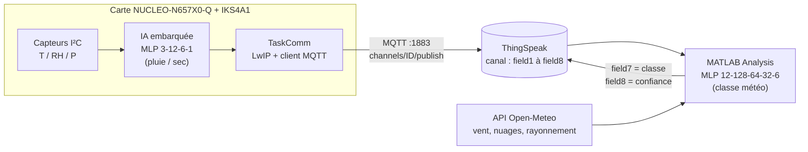

# ETRS923 – Projet IA & Objets Connectés
### Station météo connectée : IA embarquée (STM32N6) + IA Cloud (ThingSpeak / MATLAB)

**Auteurs :** SILIADIN – AMARA
**Module :** ETRS923 – IA et Objets Connectés (suite des TP1 à TP3, sujet « Cloud versus Edge AI »)

---

## Sommaire

1. [Présentation du projet](#1-présentation-du-projet)
2. [Matériel utilisé](#2-matériel-utilisé)
3. [Architecture globale](#3-architecture-globale)
4. [Arborescence du dépôt](#4-arborescence-du-dépôt)
5. [Le projet STM32](#5-le-projet-stm32)
6. [Communication : LwIP et MQTT vers ThingSpeak](#6-communication--lwip-et-mqtt-vers-thingspeak)
7. [Répartition de l'IA : Edge vs Cloud](#7-répartition-de-lia--edge-vs-cloud)
8. [Entraînement des modèles (Google Colab)](#8-entraînement-des-modèles-google-colab)
9. [Présentation des modèles](#9-présentation-des-modèles)
10. [La partie Cloud : ThingSpeak et MATLAB](#10-la-partie-cloud--thingspeak-et-matlab)
11. [Consommation : estimation et protocole de mesure](#11-consommation--estimation-et-protocole-de-mesure)
12. [Avantages de l'architecture hybride](#12-avantages-de-larchitecture-hybride)
13. [Limites et pistes d'amélioration](#13-limites-et-pistes-damélioration)
14. [Mise en route](#14-mise-en-route)

---

## 1. Présentation du projet

Le sujet du TP3 oppose deux façons de faire de l'IA sur un objet connecté :

- **l'IA embarquée (Edge AI)** : le réseau de neurones tourne directement sur le microcontrôleur, au plus près des capteurs ;
- **l'IA Cloud** : les mesures sont envoyées sur une plateforme (ici **ThingSpeak**, de MathWorks) et le réseau de neurones tourne sur un serveur distant, dans un script **MATLAB**.

Plutôt que de choisir l'un ou l'autre, nous avons fait **collaborer les deux** sur un cas concret : une mini station météo.

- La carte **STM32N6** mesure la température, l'humidité et la pression, puis décide **localement** s'il pleut ou non grâce à un petit réseau de neurones (3 → 12 → 6 → 1).
- Elle envoie ses mesures et son résultat à **ThingSpeak** en **MQTT** via Ethernet.
- Le **Cloud** reprend ces mesures, les complète avec des données externes (vent, couverture nuageuse, rayonnement… via l'API Open-Meteo) et exécute un réseau plus gros (12 → 128 → 64 → 32 → 6) qui produit une **classification météo fine en 6 classes**.

Les deux modèles sont entraînés en Python / TensorFlow sur des données historiques **Meteostat**, puis exportés (ONNX, poids en C, poids en MATLAB).

---

## 2. Matériel utilisé

| Élément | Détail |
|---|---|
| **Carte** | **NUCLEO-N657X0-Q** (MCU **STM32N657X0**, cœur Arm Cortex-M55) |
| **Shield / carte fille** | **X-NUCLEO-IKS4A1** (capteurs MEMS ST) |
| **Capteurs utilisés** | **STTS22H** (température), **LPS22DF** (pression), **SHT40-AD1B** (humidité, Sensirion) — bus I²C |
| **Réseau** | Ethernet (PHY LAN8742 de la Nucleo), adressage DHCP |
| **Interface utilisateur** | Bouton utilisateur **B1** (déclenche un cycle de mesure) et 3 LED d'état (voir §5) |
| **Cloud** | Compte ThingSpeak (offre gratuite : 1 mise à jour toutes les 15 s) + MATLAB Analysis / TimeControl |
| **Données d'entraînement** | Meteostat (station `07491`, Chambéry) |
| **Données externes (Cloud)** | API Open-Meteo |

> Les autres capteurs du shield IKS4A1 (accéléromètre, gyroscope, etc.) ne servent pas dans ce projet.

---

## 3. Architecture globale



**Champs du canal ThingSpeak :**

| Champ | Contenu | Écrit par |
|---|---|---|
| `field1` | Température (°C) | Carte |
| `field2` | Humidité relative (%) | Carte |
| `field3` | Pression locale (hPa) | Carte |
| `field4` | Probabilité de pluie (0 à 1) – IA embarquée | Carte |
| `field5` | Pluie oui/non (0/1) – IA embarquée | Carte |
| `field6` | Mesures valides (0/1) | Carte |
| `field7` | Classe météo (0 à 5) – IA Cloud | MATLAB |
| `field8` | Confiance de la classe (%) – IA Cloud | MATLAB |

---

## 4. Arborescence du dépôt

```text
ETRS923_ProjetIA_SILIADIN_AMARA/
├── README.md                          ← ce fichier
├── script google colab/
│   └── TP3.ipynb                      ← notebook d'entraînement (Meteostat → TensorFlow → ONNX / poids)
├── modeles IA/
│   ├── modele ia cloud/               ← modèle Cloud (12 entrées → 6 classes)
│   │   ├── model_ia_cloud.onnx        ← export ONNX
│   │   ├── poids_modele_ia_cloud.txt  ← poids/biais au format MATLAB
│   │   ├── script_modele_ia_cloud.m   ← script MATLAB Analysis exécuté sur ThingSpeak
│   │   └── description_modele_ia_cloud.txt
│   └── modele ia stm32/               ← modèle embarqué (3 entrées → pluie/sec)
│       ├── model_ia_stm32.onnx
│       ├── poids_modele_ia_stm32.txt
│       └── description_modele_ia_stm32.txt
└── Projet_ETRS923_YY/                 ← projet STM32CubeIDE (voir ci-dessous)
```

### Détail du projet STM32 (`Projet_ETRS923_YY/`)

Le projet a été généré avec **STM32CubeMX / CubeIDE** et suit la structure à deux sous-projets du STM32N6 : un **FSBL** (First Stage Bootloader) et l'**application**.

```text
Projet_ETRS923_YY/
├── Projet_ETRS923_YY.ioc              ← configuration CubeMX (broches, horloges, I²C, ETH, FreeRTOS…)
├── FSBL/                              ← First Stage Bootloader
│   ├── Inc/ , Src/ , Startup/         ← main.c, HAL MSP, démarrage…
│   └── STM32N657X0HXQ_AXISRAM2_fsbl.ld
├── Appli/                             ← l'application (c'est ici que se trouve notre code)
│   ├── Inc/
│   │   ├── main.h, FreeRTOSConfig.h, app_freertos.h, stm32n6xx_hal_conf.h…
│   │   ├── stts22h_reg.h, lps22df_reg.h   ← pilotes ST (température, pression)
│   │   ├── sht40.h                        ← pilote SHT40 (humidité)
│   │   ├── ia_pluie.h                     ← API de l'IA embarquée
│   │   └── ia_pluie_poids.h               ← poids du réseau + moyennes/écarts-types + seuil
│   ├── Src/
│   │   ├── main.c                         ← init HAL, horloges, périphériques, lancement de FreeRTOS
│   │   ├── app_freertos.c                 ← les 4 tâches FreeRTOS (cœur de l'application)
│   │   ├── sht40.c, stts22h_reg.c, lps22df_reg.c   ← accès capteurs
│   │   ├── ia_pluie.c                     ← inférence du réseau de neurones en C
│   │   └── stm32n6xx_it.c, hal_msp.c, hal_timebase_tim.c, system_*.c, syscalls.c, sysmem.c…
│   ├── LWIP/
│   │   ├── App/
│   │   │   ├── net_app.c/.h               ← init et pilotage de la pile LwIP (DHCP, RIF, netif)
│   │   │   ├── ts_mqtt.c/.h               ← client MQTT ThingSpeak (DNS, connexion, publication)
│   │   │   ├── ts_secrets.example.h       ← modèle des identifiants (à copier en ts_secrets.h)
│   │   │   └── app_ethernet.c/.h          ← gestion du lien Ethernet
│   │   └── Target/                        ← ethernetif.c, lwipopts.h (config LwIP)
│   ├── Drivers/STM32N6xx_HAL_Driver/      ← HAL ETH, I²C, UART
│   └── *.ld                               ← scripts d'édition de liens (plusieurs variantes mémoire)
├── Drivers/                               ← BSP (Nucleo, PHY LAN8742), CMSIS, HAL STM32N6
├── Middlewares/Third_Party/
│   ├── FreeRTOS/                          ← noyau FreeRTOS (port ARM_CM55, heap_1)
│   ├── LwIP/                              ← pile TCP/IP (dont l'appli MQTT)
│   └── CMSIS/RTOS2/                       ← couche CMSIS-RTOS v2 au-dessus de FreeRTOS
└── Secure_nsclib/                         ← interface Secure → Non-secure (TrustZone)
```

---

## 5. Le projet STM32

### 5.1 Fonctionnement général

L'application tourne sous **FreeRTOS** (via l'API CMSIS-RTOS v2). Un cycle complet est déclenché par l'appui sur le bouton **B1** et se déroule comme une **chaîne de tâches** : chaque tâche réveille la suivante au moyen d'un *thread flag* (`FLAG_GO`), et la dernière prévient la première que le cycle est terminé (`FLAG_DONE`).

```text
 B1 ──► defaultTask ──GO──► TaskSensors ──GO──► TaskIA ──GO──► TaskComm
            ▲                                                      │
            └─────────────────────── DONE ◄────────────────────────┘
```

### 5.2 Les tâches

| Tâche | Priorité | Pile | Rôle |
|---|---|---|---|
| **`defaultTask`** | Basse | 1 Ko | Surveille le bouton **B1** (avec anti-rebond). À l'appui, lance un cycle (`FLAG_GO` vers `TaskSensors`), attend la fin (`FLAG_DONE`), puis attend le relâchement du bouton. |
| **`TaskSensors`** | Normale | 4 Ko | Initialise les capteurs (STTS22H, LPS22DF, SHT40) au démarrage. À chaque cycle : **LED verte** allumée, lecture de la température, de l'humidité et de la pression (moyenne de **5 échantillons** pour température et pression), stockage dans `SensorsData`, puis réveil de `TaskIA`. Un capteur absent ou en erreur donne `NAN`. |
| **`TaskIA`** | Normale | 1 Ko | **LED rouge** allumée pendant le calcul. Appelle `ia_pluie_predire()` : vérification des plages, conversion de la pression au niveau de la mer, inférence du réseau, application du seuil. Affiche le résultat sur la liaison série puis réveille `TaskComm`. |
| **`TaskComm`** | Normale | 8 Ko | **LED bleue** allumée pendant l'envoi. **Seule tâche qui touche à LwIP** : elle fait tourner la pile réseau en permanence (voir §6) et envoie les mesures à ThingSpeak quand `TaskIA` a fini. |

> Les mesures sont partagées via une structure globale (`SensorsData`) sans mutex : la chaîne de *flags* garantit qu'une seule tâche à la fois y accède.

### 5.3 `TaskComm` et LwIP : la tâche « qui ne dort jamais »

LwIP est utilisé en mode **`NO_SYS=1`** (sans API bloquante, pile pilotée « à la main »). Il ne doit donc être appelé que depuis **un seul contexte** : `TaskComm`. Sa boucle est :

1. `net_poll()` – traite les trames Ethernet et les timers LwIP ;
2. `ts_mqtt_poll()` – gère le DNS, la connexion et la **reconnexion automatique** au broker ;
3. attente du `FLAG_GO` de `TaskIA` pendant **1 tick maximum** (pour ne jamais bloquer la pile) ;
4. si un envoi est demandé, une **petite machine à états** (`JOB_IDLE → JOB_WAIT_CONNECT → JOB_WAIT_PUBLISH`) :
   - attend la connexion MQTT (timeout **20 s**),
   - publie les 6 champs,
   - attend l'acquittement de la publication (timeout **5 s**),
   - prévient `defaultTask` (`FLAG_DONE`).

Ainsi, la pile réseau continue de répondre (ARP, DHCP, keep-alive MQTT…) même quand aucune mesure n'est envoyée.

### 5.4 Robustesse de l'application

- **Validation des mesures** : chaque valeur est contrôlée par rapport à la plage de son capteur (STTS22H : −40…125 °C, SHT40 : 0…100 %, LPS22DF : 260…1260 hPa). Une valeur hors plage ou `NAN` devient « champ non envoyé ».
- **Champ `field6` (« valide »)** : toujours envoyé, il permet au Cloud d'ignorer les cycles douteux.
- **Respect de la limite ThingSpeak** : si deux envois sont demandés à moins de 15 s d'intervalle, le second est ignoré.
- **Pression au niveau de la mer** : le modèle a été entraîné avec la pression Meteostat *ramenée au niveau de la mer*, alors que le LPS22DF mesure la pression *locale*. L'altitude d'installation (`IA_ALTITUDE_M`, dans `ia_pluie.h`) sert à convertir avant l'inférence (formule barométrique).
- **Débogage** : tous les états sont tracés sur la liaison série (`[sensors]`, `[ia]`, `[comm]`, `mqtt:`).

---

## 6. Communication : LwIP et MQTT vers ThingSpeak

La carte envoie ses données en **MQTT** (client `lwip/apps/mqtt`) vers `mqtt3.thingspeak.com:1883`, sur le topic `channels/<ID_CANAL>/publish`, en un seul message regroupant les champs `field1` à `field6`.

### Pourquoi MQTT ?

- **HTTP « simple » : écarté.** Nos essais d'envoi de requêtes HTTP en clair vers ThingSpeak n'ont pas abouti (la plateforme privilégie HTTPS pour son API REST).
- **HTTPS : écarté.** Il impose d'embarquer une pile **TLS** (mbedTLS), de gérer les **certificats racine** (stockage, validité, heure système pour la vérification…) et de consommer beaucoup de RAM/Flash et de temps CPU : démesuré par rapport au besoin (quelques octets toutes les 15 secondes).
- **MQTT : retenu.** Protocole léger, pensé pour l'IoT, **nativement supporté par ThingSpeak**, avec un client déjà fourni dans LwIP. Un seul message publié par cycle, une connexion persistante avec reconnexion automatique, et une authentification par identifiants d'appareil.

> ⚠️ Le port 1883 est **non chiffré**. C'est un compromis assumé pour un prototype pédagogique ; ThingSpeak propose aussi MQTT sur TLS (port 8883), qui demanderait la même pile TLS que le HTTPS.

### Réseau et diagnostic

- Adresse IP par **DHCP** ; si le DHCP ne fournit aucun DNS, la carte utilise `8.8.8.8`.
- Une option de diagnostic (`TS_MQTT_FORCE_IP` dans `ts_mqtt.h`) permet de contourner le DNS pour distinguer un problème de résolution d'un port bloqué par le réseau local.

### Identifiants (secrets)

Les identifiants MQTT du *device* ThingSpeak et l'ID du canal sont dans **`ts_secrets.h`**, qui ne doit **jamais être versionné**. Un modèle est fourni : `ts_secrets.example.h`.

---

## 7. Répartition de l'IA : Edge vs Cloud

| | **IA embarquée (STM32N6)** | **IA Cloud (ThingSpeak / MATLAB)** |
|---|---|---|
| **Question posée** | « Est-ce qu'il pleut ? » (binaire) | « Quel temps fait-il ? » (6 classes) |
| **Entrées** | 3 : T, RH, P (capteurs de la carte) | 12 : T, RH, P + prob. de pluie + vent, rafales, nébulosité, rayonnement, point de rosée, jour/nuit, tendance de pression, mois |
| **Taille** | 133 paramètres (~0,5 Ko) | 12 198 paramètres (~49 Ko, ~52 Ko en ONNX) |
| **Fréquence** | À chaque cycle, immédiatement | Périodique (TimeControl, ex. toutes les 10–15 min) |
| **Dépend du réseau ?** | Non | Oui |

### Pourquoi cette répartition ?

**Ce qui va sur la carte (Edge)** : une décision simple, **urgente** et **réalisable avec les seules mesures locales**.
- *Latence* : le résultat est disponible quelques millisecondes après la mesure, sans aller-retour réseau.
- *Indépendance* : la carte reste intelligente même sans Internet.
- *Bande passante* : on n'envoie qu'un résultat synthétique (probabilité + booléen) en plus des mesures.
- *Énergie* : l'inférence est négligeable en calcul (§11) alors qu'attendre une réponse du Cloud obligerait à garder la communication active.
- *Cohérence avec la doctrine du TP* : l'IA embarquée prend les « micro-décisions » en temps réel.

**Ce qui va dans le Cloud** : tout ce que la carte **ne peut pas ou ne devrait pas** faire.
- *Données qu'elle ne mesure pas* : vent, rafales, couverture nuageuse, rayonnement solaire proviennent d'une API externe, bien plus simple à consommer côté serveur.
- *Historique* : la tendance de pression (ΔP sur 1 h) s'appuie sur l'historique stocké par ThingSpeak, que la carte n'a pas à conserver.
- *Modèle plus gros* : 12 198 paramètres, ~90 fois plus de calculs que le modèle embarqué.
- *Mises à jour centralisées* : changer le modèle revient à modifier un script MATLAB, sans reflasher la carte.
- *Visualisation* : graphiques ThingSpeak et analyses MATLAB sur toutes les données collectées.

### Pourquoi le MCU et pas le NPU ?

Le **STM32N657** embarque un NPU (accélérateur Neural-ART), mais nous exécutons le réseau **sur le cœur Cortex-M55 (MCU)**. Notre modèle ne fait que **133 MAC** : l'inférence prend de l'ordre de quelques microsecondes à quelques dizaines de microsecondes sur le cœur, ce qui est largement suffisant. Utiliser le NPU aurait ajouté de la complexité (chaîne de compilation du modèle, configuration des horloges/mémoires/accès NPU, gestion du *RIF*) pour **aucun gain perceptible** : le NPU est fait pour des modèles de vision ou de gros réseaux, pas pour un mini-MLP. L'inférence est écrite en **C pur** (`ia_pluie.c`) : trois boucles, un `expf`, aucune dépendance.

---

## 8. Entraînement des modèles (Google Colab)

Tout l'entraînement est fait dans le notebook **`script google colab/TP3.ipynb`** (Google Colab, GPU optionnel). *Le nom du fichier et l'ordre des cellules peuvent évoluer ; les étapes ci-dessous restent valables.*

### Prérequis du notebook
- `pip install meteostat tf2onnx`
- Montage de Google Drive (dossier `ETRS923_IA/TP3`) pour sauvegarder les exports ;
- Le module `callbackPlots.py` fourni avec les TP (callback d'affichage de l'accuracy et fonction `count_neurons_and_synapses`) doit être présent dans ce dossier. Il n'est pas inclus dans ce dépôt.

### Contenu du notebook (dans l'ordre logique)

1. **Exemple MNIST** (rappel du TP1) : classifieur softmax de référence.
2. **Exploration Meteostat** : récupération de données horaires et journalières, aperçu et tracés.
3. **Premiers essais de classification** à partir de T, RH, P :
   - version à **11 classes** (classes complètes du TP) ;
   - version à **5 classes** regroupées (dégagé / nuageux / pluie / neige / brouillard).
4. **Extraction des poids** au format MATLAB (`W1…`, `b1…`) et des moyennes/écarts-types (`mu`, `sigma`) nécessaires à la normalisation côté Cloud.
5. **Modèle IA Cloud final** (12 entrées → 6 classes), génération de `description_modele_ia_cloud.txt`, export ONNX et poids MATLAB.
6. **Modèle IA STM32** (3 entrées → pluie/sec), seuil de décision, export ONNX et poids.

### Méthode commune

```text
Meteostat (observations horaires, station 07491)
   → nettoyage (valeurs aberrantes, lignes incomplètes)
   → étiquette à partir du code météo « coco » de Meteostat
   → (Cloud) variables calculées : point de rosée, ΔP, mois, jour/nuit, nébulosité, rayonnement, proba de pluie
   → séparation entraînement / validation / test
   → normalisation StandardScaler  (mu, sigma conservés pour le déploiement)
   → pondération des classes (class_weight)
   → entraînement Keras (Adam, EarlyStopping, ReduceLROnPlateau)
   → évaluation
   → export : ONNX (tf2onnx, opset 13) + poids MATLAB / header C
```

Les graines aléatoires (`seed = 42`) sont fixées pour la reproductibilité.

---

## 9. Présentation des modèles

### 9.1 Modèle IA embarquée (STM32) – « pluie / sec »

| | |
|---|---|
| **Entrées (3)** | `temp` (°C), `rhum` (%), `pres` (hPa, ramenée au niveau de la mer) |
| **Sortie** | Probabilité de pluie (sigmoïde) → seuil → *Sec* (0) / *Pluie* (1) |
| **Architecture** | Dense 12 (ReLU) → Dense 6 (ReLU) → Dense 1 (sigmoïde) |
| **Taille** | 19 neurones, **133 paramètres** (float32, < 1 Ko) |
| **Données** | Meteostat 2010–2025, station 07491 ; étiquettes dérivées du code `coco` (pluie = codes 7, 8, 9, 17, 18 ; sec = codes 1 à 4) |
| **Séparation** | **Chronologique 70 % / 15 % / 15 %** (passé / validation / futur) |
| **Entraînement** | Adam (lr = 0,003), perte `binary_crossentropy`, batch 64, 150 époques max, *EarlyStopping* (patience 12), *ReduceLROnPlateau* |
| **Seuil de décision** | Choisi sur la **validation** en maximisant le F1 (0,649 lors de l'exécution du notebook) |

**Choix justifiés :**
- *Séparation chronologique* : on évalue le modèle sur le « futur » qu'il n'a jamais vu, comme en conditions réelles. L'écart d'accuracy entre entraînement et validation est donc **normal** et représentatif (pas de fuite d'information par proximité temporelle).
- *Poids de classes* : le climat local est ~83 % sec / ~17 % pluvieux. Sans compensation, le réseau prédirait toujours « sec » (**83,5 % d'accuracy** pour une IA inutile). Les poids sacrifient un peu d'accuracy brute au profit du F1.
- *ReLU* : calcul très peu coûteux, adapté à un cœur Arm Cortex-M. *Sigmoïde* : donne une vraie probabilité, indispensable pour régler un seuil.

**Résultats sur le jeu de test (9 452 observations)** :

| Classe | Précision | Rappel | F1 |
|---|---|---|---|
| Sec | 0,92 | 0,87 | 0,89 |
| Pluie | 0,48 | 0,59 | 0,53 |

ROC-AUC : **0,83** — PR-AUC : **0,53** — F1 macro : **0,71** — accuracy : 0,83 (référence « toujours sec » : 0,835).
> L'accuracy seule est trompeuse ici : ce sont l'AUC et le F1 de la classe « pluie » qui montrent que le modèle détecte réellement des signatures de pluie à partir de T, RH et P.

### 9.2 Modèle IA Cloud – classification météo en 6 classes

| | |
|---|---|
| **Entrées (12)** | `temp`, `rhum`, `pres`, `prob_pluie`, `cloud_cover`, `wspd`, `wpgt`, `dwpt`, `shortwave_radiation`, `is_day`, `delta_p`, `month` |
| **Sorties (6)** | 0 Ensoleillé · 1 Partiellement nuageux · 2 Couvert · 3 Brume/Brouillard · 4 Pluie faible/Bruine · 5 Averse/Pluie soutenue |
| **Architecture** | Dense 128 (ReLU) + Dropout 0,2 → Dense 64 (ReLU) + Dropout 0,2 → Dense 32 (ReLU) → Dense 6 (softmax) |
| **Taille** | 230 neurones, **12 198 paramètres** (~49 Ko en float32) |
| **Données** | Meteostat 2015–2025, station 07491 |
| **Séparation** | 80 % entraînement / 20 % test, stratifiée |
| **Entraînement** | Adam (lr = 0,001), `categorical_crossentropy`, batch 64, 100 époques max, `class_weight` équilibré, *EarlyStopping* (patience 8, restauration des meilleurs poids), *ReduceLROnPlateau* (÷2, patience 4) |
| **Accuracy test** | **≈ 56 %** (6 classes, hasard à 17 %) |

**Choix justifiés :**
- *MLP plutôt que CNN* : données tabulaires, sans voisinage spatial ; un réseau dense est naturellement le plus léger et le plus adapté.
- *Softmax* : classes mutuellement exclusives → distribution de probabilités, qui fournit aussi la **confiance** écrite dans `field8`.
- *Dropout 0,2* : limite le surapprentissage d'un réseau plus gros.
- *Class weights* : « averse » et « brouillard » sont rares ; sans pondération, le modèle prédirait toujours la météo la plus fréquente.

### 9.3 Compromis nombre de classes / taille / précision (question 1b du TP)

Sur les trois mesures de la carte seules (T, RH, P), plus on demande de classes, plus la précision chute. Il faut aussi plus d'informations en entrée pour s'en sortir.

| Modèle | Entrées | Classes | Architecture | Paramètres | Accuracy test |
|---|---|---|---|---|---|
| Essai complet | 3 | 11 | 3-32-32-11 | 1 547 | ≈ 29 % |
| Classes regroupées | 3 | 5 | 3-32-32-5 | 1 349 | ≈ 51 % |
| **IA Cloud** | **12** | **6** | 12-128-64-32-6 | **12 198** | **≈ 56 %** |
| **IA STM32** | **3** | **2** | 3-12-6-1 | **133** | 83 % *(F1 pluie 0,53, AUC 0,83)* |

Enseignements :
1. **Réduire les classes** (11 → 5 → 2) améliore fortement la précision *et* permet un réseau minuscule : c'est ce qui rend possible l'embarqué.
2. Les classes exigent des **informations que T/RH/P ne contiennent pas** (nébulosité, vent, rayonnement) : l'ajout de ces entrées en passant au Cloud permet de retrouver 6 classes à ~56 %.
3. Les accuracy ne sont pas comparables strictement d'une ligne à l'autre (les « lignes de base » changent : 2 classes ≈ 83 % en prédisant toujours « sec », 6 classes ≈ 17 % au hasard) : d'où l'usage du F1 et de l'AUC pour le modèle embarqué.

---

## 10. La partie Cloud : ThingSpeak et MATLAB

Toute la partie Cloud s'appuie sur **ThingSpeak**.

1. **Canal ThingSpeak** : reçoit en MQTT les `field1…6` de la carte et sert de **base de données** (historique, graphiques en temps réel).
2. **MATLAB Analysis** (`script_modele_ia_cloud.m`), déclenché périodiquement par un **TimeControl** (ex. toutes les 10 à 15 minutes) :
   1. lit la dernière mesure (`thingSpeakRead`, champs 1 à 6) et **s'arrête sans rien écrire** si les données sont absentes ou si `field6 ≠ 1` ;
   2. convertit la pression locale en **pression niveau mer** (altitude de la carte) ;
   3. calcule **ΔP** à partir de l'historique du canal (fenêtre de 65 min) ;
   4. interroge **Open-Meteo** (`webread`) pour la nébulosité, le vent, les rafales, le rayonnement, le point de rosée et jour/nuit ;
   5. construit le vecteur de 12 entrées, le **normalise** (`mu`, `sigma` de l'entraînement) ;
   6. exécute la **propagation avant** du réseau (poids collés dans le script ; couches Dense + ReLU, softmax final) ;
   7. écrit la **classe** (0 à 5) dans `field7` et la **confiance** dans `field8` (`thingSpeakWrite`).
3. Un mode `'proxy'` du script recalcule les variables externes avec **exactement les mêmes formules que l'entraînement**, utile pour tester la cohérence sans dépendre d'Open-Meteo.

**Chaîne de déploiement du modèle** : TensorFlow/Keras → **ONNX** (format neutre et standardisé, plus fiable qu'un import direct de SavedModel) → poids exportés au format MATLAB. Les fichiers `.onnx` sont conservés dans `modeles IA/` comme format d'échange et de référence.

---

## 11. Consommation : estimation et protocole de mesure

> ℹ️ **Ce qui suit est une estimation par ordre de grandeur, pas une mesure.** Le protocole de mesure réel est décrit plus bas.

### 11.1 Coût de calcul

| | IA embarquée | IA Cloud |
|---|---|---|
| Multiplications-accumulations (MAC) | **133** | **~12 200** (≈ 90 ×) |
| Fonctions coûteuses | 1 `expf` (sigmoïde) | 6 `exp` (softmax) |
| Mémoire des poids | ~0,5 Ko | ~49 Ko |
| Où ça tourne | Cortex-M55 de la carte | Serveur ThingSpeak |

### 11.2 Côté carte : l'inférence est négligeable

- Environ **133 MAC + 19 activations + 1 exponentielle** : de l'ordre de quelques milliers de cycles, soit **quelques µs à quelques dizaines de µs** sur le Cortex-M55.
- Un cycle complet de la carte dure **plusieurs secondes** : 5 échantillons de température à 50 ms, attente des mesures de pression (~0,5 s), temporisation de 500 ms, puis connexion/publication MQTT (jusqu'à 20 s de timeout).
- L'inférence représente donc **bien moins de 0,01 %** de la durée du cycle : son surcoût énergétique est **noyé** dans celui des capteurs, d'Ethernet (PHY, MAC) et du noyau actif.
- C'est la **communication** et le **temps d'éveil** qui dominent la consommation de la carte, pas l'IA. Les leviers d'optimisation sont : espacer les cycles, mettre le MCU et la PHY en veille entre deux mesures, réduire le nombre d'échantillons.

### 11.3 Edge vs Cloud : le vrai comparatif énergétique

- **Edge** : décision immédiate, **sans attendre** de réponse du réseau. La liaison n'est utilisée que pour **publier** (un seul message de quelques dizaines d'octets).
- **Cloud** : la carte n'a **aucun calcul supplémentaire** (elle publie les mêmes champs), donc pas de surcoût énergétique sur l'objet. Mais pour récupérer la classe sur la carte (API Talkback du TP), elle devrait **rester connectée et interroger** le serveur, ce qui est coûteux en énergie et en latence.
- Le coût du Cloud est **déporté** : calcul du modèle (≈ 90 fois plus de MAC, mais sur des serveurs), appels HTTPS vers Open-Meteo, stockage et visualisation. Il n'est pas nul, mais il est **mutualisé** et n'affecte pas l'autonomie du capteur.
- À l'échelle d'une flotte : l'IA embarquée évite d'envoyer tout au Cloud en continu (bande passante et énergie réseau), alors que le Cloud permet d'exécuter *une* mise à jour de modèle pour *tous* les objets.

### 11.4 Protocole de mesure prévu (question 3d du TP)

1. Désactiver les GPIO et composants non essentiels.
2. Préparer un **programme témoin** exécutant toutes les étapes **sauf** le calcul du réseau de neurones.
3. Mesurer le courant d'alimentation du MCU sur le **jumper dédié** de la Nucleo (ampèremètre ou shunt + oscilloscope), pour le programme témoin puis pour le programme complet.
4. Énergie d'une inférence : **E = V × (I_IA − I_témoin) × t_IA**, ou à défaut une mesure du **temps d'inférence** (compteur de cycles DWT ou GPIO de bascule) multipliée par la différence de puissance.

| Mesure | Programme témoin | Programme avec IA | Écart |
|---|---|---|---|
| Courant moyen (mA) | *à compléter* | *à compléter* | *à compléter* |
| Durée de l'inférence (µs) | – | *à compléter* | – |
| Énergie par classification (µJ) | – | *à compléter* | – |

---

## 12. Avantages de l'architecture hybride

- **Bascule en « full Cloud » si la carte tombe en panne.** Le modèle Cloud ne dépend que des champs du canal ThingSpeak : si la carte ne fonctionne plus (ou n'est pas disponible), on peut alimenter le canal avec une autre source (autre capteur, station publique, Open-Meteo) et la classification météo continue de fonctionner sans changer le script. Le mode `'proxy'` / `'openmeteo'` du script va dans ce sens.
- **Et inversement, la carte fonctionne sans le Cloud.** Si Internet ou ThingSpeak est indisponible, la carte continue de décider « pluie / sec » localement : **dégradation gracieuse** plutôt que panne totale.
- **Redondance et recoupement** : deux avis indépendants (local et Cloud) sur la présence de pluie, comparables dans le canal (`field5` vs `field7`).
- **Latence là où elle compte** (Edge), **puissance de calcul là où elle est utile** (Cloud).
- **Mises à jour centralisées** côté Cloud (un script à modifier), le modèle embarqué étant, lui, mis à jour par reflashage du fichier `ia_pluie_poids.h`.
- **Boucle d'amélioration** conforme à l'esprit du TP : la carte agit, le Cloud apprend à partir des données accumulées, et un modèle amélioré peut ensuite être renvoyé vers la carte.

---

## 13. Limites et pistes d'amélioration

- **Précision du modèle Cloud (~56 %)** : une partie des entrées d'entraînement (`cloud_cover`, `shortwave_radiation`, `prob_pluie`, `is_day`) sont des **proxies calculés** à partir de l'humidité et de l'heure, alors que le script MATLAB utilise les **vraies valeurs d'Open-Meteo**. Cette différence de distribution peut dégrader les prédictions en conditions réelles. Piste : réentraîner avec les vraies variables (Open-Meteo historique) ou utiliser le mode `'proxy'`.
- **Cohérence du seuil embarqué** : le seuil `IA_SEUIL` du header C doit rester synchronisé avec celui affiché par le notebook (0,649 lors du dernier entraînement documenté) ; à vérifier en régénérant `ia_pluie_poids.h`.
- **Retour du résultat Cloud vers la carte (API Talkback)** : non implémenté dans cette version du projet ; la classe Cloud est consultable sur ThingSpeak.
- **Mesures de consommation** : à réaliser sur la carte (§11.4) pour remplacer les estimations.
- **Sécurité** : MQTT en clair sur le port 1883 ; passer à MQTT/TLS (8883) nécessiterait mbedTLS et la gestion des certificats.
- **Qualité de l'étiquette** : le code météo `coco` de Meteostat est un code synthétique harmonisé, pas une mesure directe ; la « vérité terrain » est donc imparfaite.
- **Compression** : si le modèle embarqué grossissait, on pourrait passer à une inférence **quantifiée int8** et/ou au **NPU** via X-CUBE-AI.

---

## 14. Mise en route

### Côté STM32
1. Ouvrir `Projet_ETRS923_YY/` dans **STM32CubeIDE**.
2. Copier `Appli/LWIP/App/ts_secrets.example.h` vers `ts_secrets.h` et renseigner les identifiants MQTT du *device* ThingSpeak et l'ID du canal.
3. Régler **l'altitude** d'installation dans `Appli/Inc/ia_pluie.h` (`IA_ALTITUDE_M`).
4. Brancher la Nucleo (liaison ST-Link / console série + câble Ethernet), compiler et flasher (FSBL puis Appli).
5. Appuyer sur **B1** pour lancer un cycle : mesures → IA → envoi MQTT. Suivre les traces sur la console série.

### Côté ThingSpeak / MATLAB
1. Créer un canal avec **8 champs** (voir tableau du §3) et un *device* MQTT autorisé à publier sur ce canal.
2. Dans **MATLAB Analysis**, coller le contenu de `modeles IA/modele ia cloud/script_modele_ia_cloud.m` et renseigner l'`channelID`, les clés d'API, la latitude/longitude et l'altitude de la carte.
3. Créer un **TimeControl** qui exécute ce script périodiquement (10 à 15 min).

### Côté entraînement
1. Ouvrir `script google colab/TP3.ipynb` dans **Google Colab**.
2. S'assurer que `callbackPlots.py` est présent dans le dossier Drive du projet.
3. Exécuter les cellules du modèle voulu ; récupérer les fichiers `.onnx` et les poids exportés.

---

*Projet réalisé dans le cadre du module ETRS923 – IA et Objets Connectés.*
